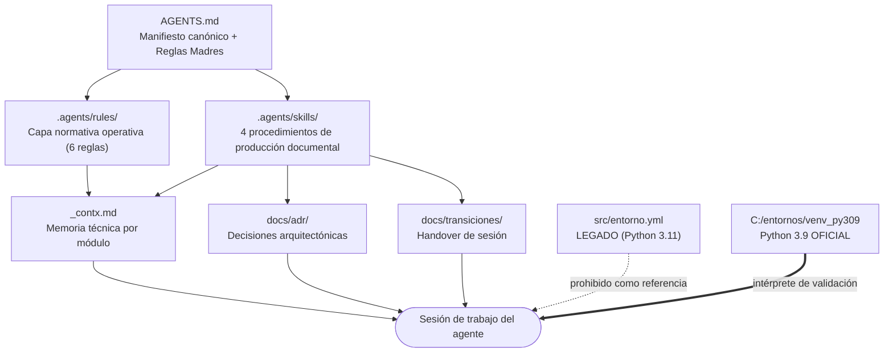

# Gobernanza del Agente y del Entorno de Trabajo — Contexto Técnico

> **Propósito**: Mapa arquitectónico de la **capa de gobernanza** del repositorio (reglas, skills, contextos, ADR y transiciones) y del **entorno de ejecución oficial**. Este documento **no duplica el contenido normativo**: lo indexa, explica cómo se relacionan sus piezas y registra los desempates ya resueltos, para que cualquier agente IA (Codex, Antigravity, subagentes) arranque sin ambigüedad.

**Ruta**: `docs/contexto_gobernanza_agente.md`
**Naturaleza**: documento de arquitectura (no normativo). La norma vive en `AGENTS.md` y `.agents/rules/`.
**Origen**: sesión del **2026-09-25**, que instituyó la capa `.agents/rules/`, declaró el entorno oficial y archivó artefactos legados.

---

## 1. Arquitectura de la Gobernanza

**Principio de diseño**: **una sola fuente de verdad por nivel**. `AGENTS.md` define la ley; `.agents/rules/` la desarrolla por tema y **la referencia sin copiarla**; las skills producen artefactos; los `_contx.md` guardan la memoria de cada módulo.

---

## 2. Componentes de la Capa de Gobernanza

| Componente | Ruta | Rol | Autoridad |
|:---|:---|:---|:---:|
| **Reglas Madres** | [`AGENTS.md`](../AGENTS.md) | Prohibición de commits y de acceso a GitHub. Inviolables. | **1** (máxima) |
| **Manifiesto** | [`AGENTS.md`](../AGENTS.md) | Identidad, contratos de datos, restricciones, protocolo de sesión. | **2** |
| **Capa normativa** | [`.agents/rules/`](../.agents/rules) | 6 reglas atómicas: prioridad, código Python, PyQt5, datos sismológicos, prohibiciones, sesión. | **3** |
| **Skills** | [`.agents/skills/`](../.agents/skills) | 4 procedimientos: generar contexto, extraer ADR, transición técnica, auditoría de librerías. | **4** |
| **Contextos de módulo** | `<script>_contx.md` | Memoria técnica del módulo (contratos, riesgos, checklist). | **5** |
| **ADR** | [`docs/adr/`](adr) | El *porqué* de las decisiones estructurales (ADR-001 … **ADR-007**). La sesión del 2026-09-25 quedó registrada en [`ADR-007-capa-normativa-reglas-entorno-oficial-python39-y-saneamiento-legado.md`](adr/ADR-007-capa-normativa-reglas-entorno-oficial-python39-y-saneamiento-legado.md). | Documental |
| **Transiciones** | [`docs/transiciones/`](transiciones) | Estado exacto y backlog al cierre de cada sesión. | Documental |
| **Contextos maestros** | [`docs/contexto_*.md`](.) | Arquitectura global, estructura de datos `DIA`, archivos de configuración, gobernanza. | Documental |

### 2.1. Inventario de la capa normativa

| Regla | Alcance |
|:---|:---|
| `00-prioridad-y-alcance.md` | Jerarquía de precedencia, desempates, Scope Lock, vigencia. |
| `10-codigo-python.md` | Entorno oficial Python 3.9, estilo, rutas Windows, excepciones, retrocompatibilidad. |
| `20-interfaz-pyqt5.md` | Invariantes C++, `.ui`/Qt Designer, subprogramas `QWidget`, `QThread`, UX/UI. |
| `30-datos-sismologicos.md` | Token `EEEECBFFIISS`, offset `+3`, árbol `DIA`, prohibiciones sobre datos. |
| `40-prohibiciones.md` | Reglas Madres, lista negra de acciones, autorizaciones requeridas. |
| `50-sesion-documentacion.md` | Protocolo de apertura/cierre, artefactos, impacto en librerías compartidas. |

---

## 3. Entorno de Ejecución Oficial

| Entorno | Versión | Estado | Uso |
|:---|:---:|:---|:---|
| `C:\entornos\venv_py309\Scripts\python.exe` | **Python 3.9.0** | ✅ **OFICIAL / OPERATIVO** | Validación, ejecución y referencia de APIs. Usado por los 7 lanzadores `.bat` y por `Spyder.bat`. |
| `C:\entornos\venv_esp32` | MicroPython | ✅ Operativo, ajeno a este repositorio | Solo `esp_32/`. |
| [`src/entorno.yml`](../src/entorno.yml) (conda `sismologia`) | Python 3.11 | ⚠️ **LEGADO / NO OPERATIVO** | Respaldo histórico. **Prohibido** como referencia de APIs o dependencias. |

> **Justificación (decisión del usuario, 2026-09-25)**: ObsPy —núcleo del procesamiento sísmico— es **estable y funcional en Python 3.9** y **no** en 3.11. Consecuencia normativa: prohibida la sintaxis y las APIs exclusivas de 3.10+.

---

## 4. Contratos Operativos de Sesión

* **Apertura (Scope Lock)**: el usuario declara un directorio de trabajo exclusivo; el agente lee reglas, skills aplicables y `_contx.md` del alcance, y **no escribe nada** hasta recibir instrucción explícita.
* **Cierre (4 pasos)**: contextos técnicos → ADR → transición técnica → resumen de cambios.
* **Rutas canónicas de artefactos**:

| Artefacto | Ruta canónica | Nomenclatura |
|:---|:---|:---|
| Contexto de módulo | **Junto al script** | `<nombre>_contx.md` |
| Decisión arquitectónica | `docs/adr/` | `ADR-NNN-titulo.md` |
| Transición | `docs/transiciones/` | `transicion_YYYYMMDD_HHMM.md` |
| Contexto maestro | `docs/` | `contexto_*.md` |

### 4.1. Desempates ya resueltos (no volver a debatirlos)

| Conflicto | Resolución vigente |
|:---|:---|
| Skill `generar_contexto.md` indica `docs/context/<n>_context.md` + índice en GitHub | **Anulado**: la salida canónica es `<script>_contx.md` junto al script; el paso de GitHub queda prohibido por la Regla Madre 2. |
| Reportes de auditoría vs. realidad del código | Los reportes son **fotos generadas**; ante duda, regenerarlos con el intérprete 3.9 desde la raíz del repositorio. |
| Contexto (`_contx.md`) vs. código real | Prevalece la **funcionalidad real documentada**; se propone corrección conservadora y se reporta la discrepancia. |

---

## 5. Estado de Artefactos Legados (depurados el 2026-09-25)

| Artefacto | Estado | Detalle |
|:---|:---|:---|
| `src/programa_integrado_alt.py` | **Archivado** → [`obsoletos/src/programa_integrado_alt.py`](../obsoletos/src/programa_integrado_alt.py) | Predecesor congelado de `programa_integrado.py`; ningún módulo lo importaba. Ver [`programa_integrado_alt_contx.md`](../obsoletos/src/programa_integrado_alt_contx.md). |
| `src/__pycache__/programa_integrado_alt.cpython-39.pyc` | Eliminado | Bytecode huérfano tras el traslado. |
| [`reporte_arquitectura_rsa.md`](../reporte_arquitectura_rsa.md) y [`reporte_librerias_rsa.md`](../reporte_librerias_rsa.md) | Regenerados | Reflejan el estado real: **33 archivos Python** bajo `src/`, topología en estrella (solo `programa_integrado.py` importa subprogramas). |

---

## 6. Riesgos y Deuda Técnica

* **Divergencia ley ↔ reglas**: si `.agents/rules/` contradice `AGENTS.md`, gana `AGENTS.md` y la regla debe corregirse en esa misma sesión.
* **Envejecimiento de los reportes de auditoría**: son artefactos generados, no se actualizan solos. Deben regenerarse tras cada refactorización relevante.
* **Módulos muy grandes** (candidatos a descomposición, según el reporte vigente): `subprogramas/procesamiento_integrado.py` (1.785 líneas), `subprogramas/fases.py` (**1.454**), `subprogramas/reporte_acumulado.py` (1.078), `librerias/rsa_pdf_catalogo.py` (937).
* **Módulos satélite sin contexto**: `modulos externos/vigilante_caudales.py` sigue sin `_contx.md` (diferido por decisión del usuario).
* **Subprogramas legados `QMainWindow`**: pendientes de migración a `QWidget` puro (ADR-004); `subprogramas/fases.py` e `subprogramas/inicio.py` aún exponen `QMainWindow`.

---

## 7. Checklist de Verificación

- [ ] Leí `AGENTS.md` y las reglas de `.agents/rules/` aplicables antes de actuar.
- [ ] Verifiqué el nivel jerárquico de cada instrucción y reporté contradicciones.
- [ ] Validé con Python 3.9 (`venv_py309`) y no usé `src/entorno.yml` como referencia.
- [ ] Escribí el contexto del módulo como `<script>_contx.md`, junto al script.
- [ ] Regeneré los reportes de auditoría si la sesión cambió la topología de módulos.
- [ ] No dejé referencias rotas ni artefactos legados sin marcar.
