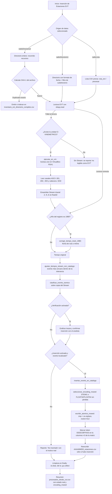

> [!NOTE]
> **Historial documental**: la versión previa a la sesión del **2026-09-28** (corrección de codificación MiniSEED y del reporte de inserción) quedó respaldada en [`respaldos/Insercion de estaciones EVT_contx_20260823.md`](<respaldos/Insercion de estaciones EVT_contx_20260823.md>).

# `Insercion de estaciones EVT.py` — Contexto Técnico para Agentes IA

> Aplicación especializada en PyQt5 y ObsPy para la normalización, conversión e inserción atómica de registros acelerográficos binarios Kinemetrics (EVT / K2 / ETNA) hacia los catálogos diarios y repositorios MiniSEED de la Red Sísmica de Alerta (RSA), con codificación MiniSEED adaptativa sin pérdida (`STEIM1` para recuentos enteros, `FLOAT32`/`FLOAT64` para registros en m/s²), deduplicación criptográfica SHA-1 y fallback automático mediante máquina virtual DOS/Windows `kw2asc.exe`.

**Ruta**: `c:/proyectos/rsa_sismologia/modulos externos/Insercion de estaciones EVT.py`  
**LOC**: 1.083 líneas | **Lenguaje**: Python 3.9 (PyQt5, ObsPy, NumPy, CSV)  
**Orígenes de datos en la interfaz** (tres `QRadioButton`, no "modos" separados): 
- `radioDirectorio1` — directorio con formato de fecha: se elige la estación/descarga y luego el año; filtro por subdirectorio (`cmbx_eventos` / `cmbx_subdirectorios`).
- `radioDirectorio2` — directorio entero: recorrido recursivo con inventario deduplicado por SHA-1.
- `radioLista` — lista CSV previa (columnas `ruta_evt` / `procesar`).
- **La VM `O:\KINEMETRICS` no es un modo**: es un *fallback* automático dentro de `procesar_archivo_evt()` cuando `read(format='KINEMETRICS_EVT')` falla.
- Destino alternativo: `radio_estacion_serial` guarda el `.mseed` en `<destino>/<SERIAL>/` con nombre `<SERIAL>_<AAAAMMDD_HHMMSS>.mseed`.

---

## 1. Identidad, Alcance y Propósito

Las estaciones acelerográficas autónomas registran eventos por disparo de umbral en tarjetas locales que se descargan periódicamente. Este script procesa dichas descargas y las incorpora a los catálogos y trazas de la RSA.

### Objetivos Clave:
1. **Normalización Canónica de Estaciones**: Mapea variantes históricas de nombres de carpetas y códigos de cabecera binaria a los 18 códigos oficiales de 4 letras de la RSA (`EEAN`, `EEAS`, `EEBA`, `CHAB`, `CHAC`, `MABA`, `MACI`, `MADE`, `DPBA`, `DPCI`, `DPME`, `AHUA`, `MIRA`, `CICA`, `UDAZ`, `UCET`, `UCAO`, `REGC`).
2. **Escritura MiniSEED Estándar y Atómica**: Escribe archivos `.mseed` con longitud de registro **`reclen=512`** y **codificación adaptativa sin pérdida** (`STEIM1` para recuentos enteros; `FLOAT32`/`FLOAT64` para registros calibrados en m/s²), utilizando reemplazo atómico seguro (`.<archivo>.mseed.tmp` $\to$ `<archivo>.mseed`) para evitar corrupción ante interrupciones.
3. **Manejo Seguro de Máquina Virtual Kinemetrics (`kw2asc.exe`)**: Valida la existencia de la unidad montada `O:\KINEMETRICS` antes de invocar la reconstrucción VM; si no está disponible, reporta el archivo como no legible y continúa con el resto del lote sin colapsar.
4. **Deduplicación Criptográfica (SHA-1)**: En el procesamiento de directorios completos, genera hashes SHA-1 para omitir duplicados físicos e indexa el inventario en `inventario_evt_directorio_completo.csv`.
5. **Liberación Estricta de Memoria**: El bloque `finally:` de `procesar_archivo_evt()` ejecuta `st.clear()`, `del st` y `gc.collect()` para procesar miles de archivos continuos sin fugas de RAM. (`plt.close('all')` **no** está en el `finally`: se ejecuta al inicio del bloque de verificación y las figuras se retienen en `ventana._figs_abiertas`, máximo 5.)
6. **Inserción Atómica en Catálogo `DIA`**: Actualiza las matrices `AAAAMMDD_estaciones.csv` preservando columnas, cabeceras y orden canónico de fases.

---

## 2. Diagrama de Arquitectura y Flujo de Datos

---

## 3. Contratos de Datos y Normalización

### 3.1. Mapeo Oficial de Estaciones
Diccionarios depurados sin duplicados en `DICCIONARIO_ESTACIONES_EVT` y `DICCIONARIO_ESTACIONES_DIRECTORIO`:
* Chanlud: `CHAB` (Base), `CHAC` (Cima)
* Mazar: `MABA` (Base), `MACI` (Cima), `MADE` (Margen Derecha)
* Paute: `DPBA` (Base), `DPCI` (Cima), `DPME` (Media)
* Red Urbana / Regional: `EEBA`, `EEAN`, `EEAS`, `AHUA`, `MIRA`, `CICA`, `UDAZ`, `UCET`, `UCAO`, `REGC`.

### 3.2. Formato de Salida MiniSEED
* Archivo: `<ESTACION>_<AAAAMMDD_HHMMSS>.mseed`
* Reclen: `512` bytes.
* **Codificación adaptativa sin pérdida (crítico)**: `STEIM1` sólo admite `int32` **exacto** (`obspy/io/mseed/core.py:770`; al forzarla, los registros en coma flotante fallaban con `Wrong dtype for Stream[0].data for encoding STEIM1`). `seleccionar_encoding_mseed()` elige la codificación que representa el registro **sin redondear ni descartar decimales**, de modo que ambos orígenes de datos de la RSA conviven de forma transparente:

| Datos de entrada | Codificación | Tratamiento |
|---|---|---|
| Recuentos enteros `int16`/`int32`/`int64` | `STEIM1` | Canónica del proyecto (ADR-002), comprimida; `int64` se ajusta a `int32` si está en rango |
| `float` con valores enteros exactos (ETNA vía VM `kw2asc`) | `STEIM1` | Conversión exacta a `int32`: sin pérdida, mantiene la compresión |
| `float32`/`float64` con decimales (ETNA calibrado en m/s², p. ej. UCHU canal `0`) | `FLOAT32` / `FLOAT64` | **Se conservan íntegros, sin redondeo** |
| Stream mixto (enteros + flotantes) o enteros fuera de rango `int32` | `FLOAT64` | Única codificación que representa ambos sin pérdida |

  * La codificación utilizada se informa en la consola del IDE (`[MSEED] <archivo> | encoding ...`) y en la columna `encoding_mseed` del reporte `procesados_desde_csv.csv`.
  * Sólo se rechaza lo que MiniSEED no puede representar: Stream vacío y dtypes no numéricos. Un registro con `NaN`/`inf` se escribe tal como llegó, con aviso explícito.
  * **Origen verificado de los flotantes (dato crítico)**: [`read(..., format='KINEMETRICS_EVT')`](<../modulos externos/Insercion de estaciones EVT.py>) usa el lector de ObsPy, cuyo `read_file()` tiene **`raw=False` por defecto** (`obspy/io/kinemetrics/evt.py:81`). Por tanto **toda** lectura nativa de un EVT entrega los datos **calibrados en m/s²** (`float64`), con canales `"0"`, `"1"`, `"2"` y `calib=1.0` — de ahí identificadores como `.UCHU..0`. Sólo el camino ASCII por VM entrega recuentos. Ésta es la razón de que forzar `STEIM1` rompiera el 100% de las lecturas nativas: antes del cambio que introdujo el `encoding` explícito, ObsPy elegía `FLOAT64` automáticamente y todo funcionaba.

---

## 4. Métodos y Funciones Principales

| Función / Método | Tipo | Descripción |
|---|---|---|
| `escribir_atomico_mseed(stream, destino)` | I/O MiniSEED | Escritura atómica con `reclen=512` y codificación adaptativa; **devuelve la codificación** utilizada (`STEIM1`/`FLOAT32`/`FLOAT64`). |
| `seleccionar_encoding_mseed(stream, contexto)` | Codificación | Elige la codificación sin pérdida según los dtypes y adapta las trazas in situ. Devuelve `(encoding, informe)` con dtypes de origen, trazas adaptadas y aviso legible. |
| `normalizar_codigo_estacion_desde_directorio(nombre)` | Parser | Convierte nombres de carpetas de estaciones al código canónico de 4 letras. |
| `normalizar_codigo_estacion_desde_evt(codigo)` | Parser | Traduce códigos de cabecera binaria del ETNA (búsqueda exacta e insensible a mayúsculas). |
| `corregir_tiempo_reset_1980(stream, archivo)` | Algoritmo | Corrige estampas desfasadas a 1980 usando la fecha del directorio o `mtime`. |
| `ajustar_tiempos_stream_con_catalogo(...)` | Sincronización | Empareja el stream con el evento del catálogo más cercano dentro de la tolerancia. |
| `insertar_evento_en_catalogo(..., reporte=None)` | Base de Datos | Escribe el MiniSEED y marca la columna de la estación. **Rellena `reporte`** con el estado real: `insertado`, `motivo`, `ruta_mseed`, `encoding_mseed`, `estacion`, `token`, `columna`. |
| `procesar_archivo_evt(...)` | Orquestador | Lee el EVT (ObsPy o VM), ajusta tiempos, clasifica, verifica e inserta; sólo reescribe la matriz `AAAAMMDD_estaciones.csv` cuando hubo inserción real. |
| `ejecutar_en_vm(...)` | Integración VM | (**En [`src/librerias/metodos_rsa.py`**](<../src/librerias/metodos_rsa.py>), no en este módulo) Ejecuta `kw2asc.exe` en VirtualBox `RSA1` y ensambla el Stream ASCII triaxial (Z, N, E) en `float32`. |

---

## 5. Deuda Técnica y Riesgos Mitigados

1. **Ausencia de VM Kinemetrics**: Mitigado con detección preventiva de `O:\KINEMETRICS` y fallback a ObsPy.
2. **Duplicación de Archivos**: Mitigado con hashing SHA-1 en Modo 2.
3. **Consumo de Memoria**: Mitigado con liberación explícita `st.clear()`, `del st` y `gc.collect()`.
4. **Error `Wrong dtype for Stream[0].data for encoding STEIM1` (resuelto)**: la codificación estaba forzada a `STEIM1`, que ObsPy sólo admite para `int32`; los registros ETNA en punto flotante (calibrados en m/s²) fallaban y no se insertaban. Resuelto con `seleccionar_encoding_mseed()`, que preserva los flotantes en `FLOAT32`/`FLOAT64` sin redondearlos y mantiene `STEIM1` para los recuentos enteros.
5. **Reporte de inserción falso positivo (resuelto)**: `insertar_evento_en_catalogo()` retornaba la matriz sin insertar cuando la estación no figuraba en `estaciones.csv` o el evento no existía en la matriz del día, y el llamador marcaba igualmente `'Insertado'` y reescribía el CSV. Ahora el estado real viaja en `reporte`, la matriz sólo se reescribe si hubo inserción y la columna `insercion` documenta el motivo del descarte.
6. **Deuda registrada (no corregida por alcance)**: [`src/librerias/metodos_rsa.py`](<../src/librerias/metodos_rsa.py>) `ejecutar_en_vm()` construye las trazas ASCII con `dtype=np.float32`; la selección de codificación se aplica aguas abajo, en este módulo. Si otro consumidor escribe ese Stream forzando `STEIM1`, reproducirá el mismo error.
7. **Cobertura de códigos de cabecera EVT**: `DICCIONARIO_ESTACIONES_EVT` sólo define 10 alias (`ACC1`, `CHB`, `CHC`, `MZB`, `MZC`, `MZD`, `PABA`, `PACI`, `UCET`, `UDEC`). Los códigos sin alias pasan sin homologar y, si no coinciden literalmente con `datos/estaciones.csv`, la inserción se descarta (ahora de forma explícita y trazable).
8. **`"EEEBASE": "EEAS"`** en `DICCIONARIO_ESTACIONES_DIRECTORIO`, mientras el catálogo define `EEE-BASE → EEBA`. Afecta sólo a la estación sugerida del inventario, no a la columna del catálogo (que se resuelve desde la cabecera EVT). **Pendiente de confirmación por el usuario.**
9. **Pendiente de retirar por criterio del usuario (2026-09-28)**: el método `verificar_encoding_mseed()` de `VentanaInsercionEVT` y el guion suelto [`pruebas/validar_encoding_mseed_evt.py`](<../pruebas/validar_encoding_mseed_evt.py>) usan **datos sintéticos**, que el usuario considera ruido sin valor. La validación de este módulo se hace con **archivos reales**: `py_compile` y la revisión de las líneas `[MSEED]`/`encoding_mseed` en consola y reporte. No crear guiones de prueba nuevos.

---

## 6. Checklist de Regresión

Antes de validar cualquier modificación en `Insercion de estaciones EVT.py`, verificar:
- [ ] La compilación con `python -m py_compile` retorna código 0.
- [ ] Al procesar un lote real, la consola muestra `[MSEED] <archivo> | encoding ...` con `STEIM1` en los recuentos enteros y `FLOAT32`/`FLOAT64` en los registros con decimales, y la columna `encoding_mseed` del reporte lo refleja.
- [ ] Todo `.mseed` generado tiene longitud de registro múltiplo de `512` bytes.
- [ ] Un registro en unidades físicas (m/s²) se escribe **sin redondeo** (nunca se convierte en ceros).
- [ ] El reporte `procesados_desde_csv.csv` incluye la columna `encoding_mseed` y un estado de inserción veraz.
- [ ] Ante estación no catalogada o evento ausente en la matriz, la matriz del día queda **intacta** y el motivo se informa.
- [ ] En ausencia de la unidad `O:`, el script no colapsa y continúa mediante ObsPy.
- [ ] La matriz `AAAAMMDD_estaciones.csv` se actualiza de forma atómica sin corromper cabeceras.
