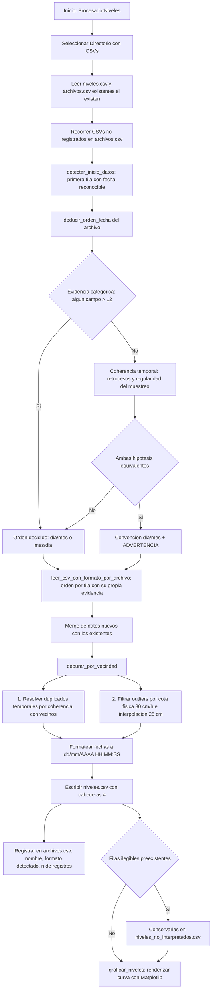

# `niveles_embalses.py` — Contexto Técnico para Agentes IA

> Aplicación en PyQt5 y Matplotlib para la consolidación, deducción del formato de fecha por evidencia y coherencia temporal, deduplicación y depuración física de registros de nivel de embalses (presas Chanlud y Labrado), administrando los archivos maestros `niveles.csv` y el inventario `archivos.csv`.

**Ruta**: `c:/proyectos/rsa_sismologia/modulos externos/niveles_embalses.py`  
**LOC**: ~1.280 líneas | **Lenguaje**: Python 3.9 (PyQt5, Matplotlib, `statistics`, `re`, `math`, rsa_io)  
**Archivos de Salida**: `niveles.csv` (serie consolidada y depurada), `archivos.csv` (inventario con el formato detectado), `niveles_no_interpretados.csv` (rescate de filas ilegibles, sólo si existen), archivos CAD `*.dxf` (gráficos vectoriales seccionados con marco y malla).

---

## 1. Identidad, Alcance y Propósito

Las estaciones limnimétricas en las presas registran los niveles del agua en archivos CSV periódicos con formatos de fecha variables según el registrador o la exportación. Este módulo procesa un lote de archivos, resuelve conflictos de solapamiento y genera una serie continua y limpia.

### Objetivos Clave:
1. **Deducción del Orden Día/Mes por Archivo (`deducir_orden_fecha`)**: el formato de la información integrada no es fijo (conviven `DD/MM/AAAA` y `MM/DD/AAAA`), por lo que **no se presupone** el orden. Se deduce en este orden de prioridad:
   1. **Cambio de día observado en la propia serie** (`deducir_orden_por_cambio_de_dia`) — **criterio principal**: los registros son horarios (24 por día), de modo que al pasar de un día al siguiente cambia un único campo de la fecha. Si cambia el **segundo** campo y el primero permanece, el segundo es el día (mes/día/año); si cambia el **primer** campo, es día/mes/año. En el cambio de mes cambian ambos y decide el campo que vuelve a 1. Es directo y concluyente incluso cuando todos los valores son ≤ 12.
   2. **Evidencia categórica** (`sugerir_orden_por_evidencia`): un campo mayor que 12 no puede ser un mes; respaldo cuando no hay cambio de día (p. ej. archivo de un solo día).
   3. **Coherencia temporal** (`medir_coherencia_temporal`): con todos los registros ambiguos y sin cambio de día, se interpreta la serie con ambas hipótesis y gana la que reproduce un muestreo regular.
   4. **Convención local**: si ambas interpretaciones son equivalentes, se asume día/mes/año y **se advierte** para revisión del analista.
   * La deducción es **por fila además de por archivo**: si un archivo mezcla registros que sólo pueden ser día/mes con otros que sólo pueden ser mes/día, cada fila se resuelve con su propia evidencia y se advierte la mezcla.
   * **Diagnóstico de filas sueltas invertidas** (`detectar_filas_con_orden_invertido`): si un registro aislado rompe la cadencia del archivo y, leído con el orden alterno, encajaría en ella, se avisa en la consola mostrando ambas fechas. Cubre el síntoma de *un único registro* exportado con el orden cambiado. **No corrige automáticamente**: informa para que decida el analista.
   * **El mismo criterio se aplica al releer el consolidado** (`normalizar_fechas_consolidadas`), porque `niveles.csv` se relee y reescribe en cada ejecución: sin esto, un consolidado escrito en mes/día se invertiría en cada pasada.
   * *Fallo corregido*: la versión anterior probaba una lista fija de 12 formatos con `%d/%m/%Y` en primer lugar. Si el archivo empezaba en un día del 1 al 9, en las primeras ~80 filas ninguna fecha delataba el orden, elegía día/mes por defecto y **invertía día y mes en silencio** (además de descartar las filas con día > 12).
2. **Depuración por Vecindad y Filtrado de Outliers (`depurar_por_vecindad`)**:
   - **Resolución de duplicados**: Si existen lecturas coincidentes en el mismo instante de tiempo, selecciona el valor más armónico evaluando la coherencia cuadrática con sus vecinos temporalmente más cercanos.
   - **Cota física de variación por hora (`max_delta_por_hora=0.30` m/h)**: Descarta anomalías o picos de ruido del sensor incompatibles con la física hidráulica del embalse.
   - **Interpolación lineal entre vecinos (`umbral_abs_interpolacion=0.25` m)**: Elimina disparos espurios aislados.
3. **Persistencia Estructurada y Respeto de Cabeceras**:
   - `detectar_inicio_datos()` localiza en cada archivo fuente la primera fila con fecha reconocible, de modo que cabeceras y metadatos de tamaño variable queden fuera **sin descartar registros válidos**. *Fallo corregido*: la versión anterior descartaba siempre `datos_crudos[3:]`, perdiendo registros reales en archivos con 0, 1 o 2 líneas de cabecera.
   - `quitar_cabecera_si_corresponde()` (función local) detecta las tres líneas `#` de los archivos ya consolidados (`niveles.csv`, `archivos.csv`) antes de releerlos.
   - Guarda `niveles.csv` y `archivos.csv` con cabeceras explicativas iniciadas con `#`.
   - Las filas de `niveles.csv` que no puedan interpretarse **no se descartan en silencio**: se conservan íntegras en `niveles_no_interpretados.csv` (dato irremplazable).
4. **Visualización Gráfica**: Plotea la serie resultante con formateo temporal legible (`DateFormatter("%d/%m/%Y %H:%M")`).
5. **Seccionamiento de Niveles y Exportación Vectorial DXF (Formato Hidrológico Oficial)**:
   - Permite al usuario definir un corte temporal específico mediante selectores `QDateTimeEdit` (fecha inicio y fin).
   - Permite fijar los niveles mínimo y máximo del marco del gráfico mediante controles numéricos `QDoubleSpinBox`.
   - **Malla vertical por días y meses**: traza una línea discontinua (`DASHED`, capa `MALLA_DIAS`) para cada día calendario del mes, y una línea continua gruesa (`MALLA_MESES`) para la transición del 1.º de cada mes.
   - **Franja inferior de meses correspondientes**: genera una banda sombreada (`FONDO_MESES`, color gris) con compartimentos independientes para cada mes del rango (`JUNIO`, `JULIO`, `AGOSTO`, etc.) con texto centrado en mayúsculas.
   - **Eje Y y cotas horizontales**: cuadrícula horizontal continua (`MALLA_HORIZONTAL`) en cotas principales, marcas exteriores a la izquierda, valores numéricos y rótulo rotado 90° **`NIVEL DEL EMBALSE (m)`**.
   - **Curva de nivel**: polilínea continua `LWPOLYLINE` en color rojo puro (capa `NIVELES`, color 1).
   - **Previsualización interactiva**: renderiza en Matplotlib con dos ejes acoplados (`hspace=0`) que reproducen de forma idéntica la composición del archivo DXF antes de exportarlo.

---

## 2. Diagrama de Arquitectura y Flujo de Datos



---

## 3. Contratos de Datos y Configuración

### 3.1. Archivo Consolidado `niveles.csv`
Estructura delimitada por punto y coma (`;`):
* Fila 0–2: Cabeceras descriptivas con prefijo `#`.
* Columna 0: Identificador de estación / sensor.
* Columna 1: Fecha y hora en formato canónico `dd/mm/AAAA HH:MM:SS`.
* Columna 2: Nivel medido en metros sobre el nivel del mar (m s.n.m.) con formato decimal compacto.

### 3.2. Archivo de Inventario `archivos.csv`
Lista única de archivos `.csv` ya procesados para evitar re-lecturas redundantes, con trazabilidad del formato deducido:
* Columna 0: nombre del archivo.
* Columna 1: formato de fecha detectado (p. ej. `%m/%d/%Y %H:%M:%S`).
* Columna 2: número de registros válidos incorporados.
* *Compatibilidad*: sólo se lee la columna 0, por lo que los inventarios antiguos de una sola columna siguen siendo válidos.

### 3.3. Archivo de Rescate `niveles_no_interpretados.csv`
Sólo se crea si al releer `niveles.csv` aparecen filas ilegibles. Contiene esas filas tal cual, sin depurar, para revisión manual. **Nunca se pierde información.** Este archivo está excluido del recorrido de archivos fuente, de modo que no se reprocesa a sí mismo.

---

## 4. Métodos y Funciones Principales

| Función / Método | Tipo | Descripción |
|---|---|---|
| `ProcesadorNiveles` | Clase (QWidget) | Ventana principal de selección de carpeta y procesamiento. |
| `analizar_estructura_fecha(texto)` | Parser (módulo) | Descompone una marca de tiempo en separador, campos, año y presencia de hora, **sin** presuponer el orden día/mes. Acepta `/`, `-`, `.`, año de 2 o 4 dígitos, hora opcional, fecha sin hora y **formato ISO año/mes/día** (`orden_fijo='YMD'`). |
| `construir_formato_fecha(estructura, orden)` | Parser (módulo) | Construye la cadena `strptime` a partir de la estructura detectada y el orden `DMY`/`MDY`. |
| `sugerir_orden_por_evidencia(estructuras)` | Deducción (módulo) | Vota el orden día/mes usando evidencia categórica (campos > 12). Devuelve `(orden, votos_día_primero, votos_mes_primero)`. |
| `medir_coherencia_temporal(textos, estructura, orden)` | Deducción (módulo) | Mide retrocesos cronológicos y regularidad del muestreo para una hipótesis de orden. |
| `deducir_orden_por_cambio_de_dia(textos, maximo_comparaciones=200)` | Deducción (módulo) | **Criterio principal**: observa el cambio de día en la serie horaria y determina cuál de los dos campos es el día. Devuelve `(orden, detalle)`. |
| `interpretar_fecha(fecha_txt, orden_archivo, formato_referencia)` | Parser (módulo) | Convierte una fecha aplicando el orden del archivo y, si la fila lo delata, el que esa fila impone. |
| `normalizar_fechas_consolidadas(filas, informe=None)` | Relectura (módulo) | Deduce el orden del `niveles.csv` ya escrito antes de releerlo, para no invertirlo en cada pasada. Devuelve `(normalizadas, no_interpretadas)`. |
| `deducir_orden_fecha(textos)` | Deducción (módulo) | Núcleo: cambio de día → evidencia categórica → coherencia temporal → convención con advertencia. Devuelve `(orden, informe)`. |
| `detectar_inicio_datos(filas, columna_fecha=1)` | Parser (módulo) | Índice de la primera fila con fecha reconocible: cabeceras de tamaño variable sin perder registros. |
| `detectar_filas_con_orden_invertido(marcas, factor_cadencia=5.0)` | Diagnóstico (módulo) | Señala filas sueltas que rompen la cadencia del archivo y que con el orden alterno encajarían en ella (registro exportado con el orden invertido). Sólo informa. |
| `determinar_formato_fecha(fechas, informe=None)` | Parser | Formato `strptime` del archivo; completa `informe` con el orden, la evidencia y la advertencia. |
| `leer_csv_con_formato_por_archivo(ruta, informe=None)` | Parser / I/O | Extrae y normaliza filas de un archivo individual; resuelve el orden **por fila** con la evidencia propia del registro. |
| `depurar_por_vecindad(filas)` | Algoritmo | Elimina duplicados por distancia a vecinos y descarta outliers físicos. |
| `procesar_archivos(directorio)` | Flujo Principal | Orquesta lectura, fusión, depuración, guardado e inventario, e informa en consola el formato deducido por archivo. |
| `graficar_niveles(niveles, formato)` | Visualización | Grafica la serie temporal con `DateFormatter` y cuadrícula. |
| `calcular_paso_optimo(rango, divisiones_deseadas)` | Utilidad Matemática | Calcula paso estético (1, 2, 5 o 10 x 10^k) para graduar los ejes de cota y tiempo. |
| `cargar_niveles_desde_csv(ruta_csv)` | I/O / Datos | Carga `niveles.csv` consolidado preexistente para poblar controles de corte sin reprocesar. |
| `actualizar_controles_corte()` | UI / Sincronización | Ajusta widgets de fecha y nivel a los extremos reales de la serie activa. |
| `obtener_datos_corte()` | Validación / Filtro | Valida coherencia de fechas/cotas y devuelve registros dentro del rango temporal. |
| `previsualizar_corte()` | Visualización | Renderiza en Matplotlib la sección recortada con las líneas de cota del marco. |
| `generar_dxf_corte()` | Exportación | Orquesta el diálogo de guardado y exporta el corte vectorial a DXF. |
| `escribir_archivo_dxf(...)` | Generador CAD | Escribe archivo DXF universal AutoCAD R12 (`AC1009`) compatible con motores ODA (Vectorworks/AutoCAD) con capas `MARCO`, `MALLA`, `NIVELES`, `TEXTOS` y `POLYLINE` + `VERTEX` + `SEQEND`. |

### 4.1. Trazabilidad en la consola del IDE
Por cada archivo procesado se imprime:

```text
[FORMATO] archivo.csv -> %m/%d/%Y %H:%M:%S | sin evidencia categórica (día y mes <= 12 en todos
          los registros): coherencia temporal -> retrocesos día/mes 0 vs mes/día 0,
          regularidad 0.97 vs 1.00 -> mes/día/año
          registros válidos: 72 | filas de datos desde la línea 1 | descartadas: 0
[AVISO] archivo.csv: <advertencia cuando la deducción no es concluyente>
```

---

## 5. Pautas para Integración en `src/programa_integrado.py`

Cuando se incorpore al menú principal:
1. Podrá ubicarse en la categoría de **Instrumentación y Monitoreo de Presas** junto a `caudales_filtraciones.py`.
2. Utiliza `rsa_io.py` (`lectura_archivo`, `escritura_archivo`), garantizando coherencia absoluta con el resto del proyecto.

---

## 6. Checklist de Regresión

Antes de validar cualquier modificación en `niveles_embalses.py`, verificar:
- [ ] `python -m py_compile "modulos externos/niveles_embalses.py"` retorna código 0.
- [ ] Al procesar un archivo real, la consola muestra `[FORMATO] <archivo> -> ... | cambio de día «...» -> «...»` con el orden correcto, y las fechas escritas en `niveles.csv` coinciden con las del archivo de origen.
- [ ] Un archivo `MM/DD/AAAA` ambiguo (todos los campos ≤ 12) se deduce como mes/día por el **cambio de día**; uno `DD/MM/AAAA` ambiguo se mantiene como día/mes.
- [ ] Una serie diaria que cruza de mes (mes categórico + mes ambiguo) mantiene el orden del archivo y no genera falsos positivos.
- [ ] Un último registro exportado con el orden invertido se detecta y se informa con ambas fechas candidatas.
- [ ] Las fechas ISO (`AAAA-MM-DD`, con y sin hora) se siguen reconociendo como año/mes/día.
- [ ] Las cabeceras de 0, 1, 2 o 3 líneas no provocan pérdida de registros.
- [ ] Cuando la deducción no es concluyente, se emite **advertencia** en la consola y en el reporte.
- [ ] Todas las fechas escritas en `niveles.csv` cumplen `dd/mm/AAAA HH:MM:SS` y son legibles con `lectura_archivo()`.
- [ ] `archivos.csv` registra nombre, formato detectado y nº de registros; una segunda pasada no reprocesa ni duplica.
- [ ] Una fila ilegible de `niveles.csv` se conserva en `niveles_no_interpretados.csv`, nunca se descarta.
- [ ] Registros con timestamps duplicados son resueltos sin generar saltos abruptos en la gráfica.
- [ ] La previsualización gráfica reproduce la maquetación hidrológica: curva roja, cotas principales horizontales, divisiones discontinuas por día, líneas continuas de mes y franja inferior con nombres de mes centrados en mayúsculas.
- [ ] La exportación DXF genera capas normalizadas (`MARCO`, `MALLA_HORIZONTAL`, `MALLA_MESES`, `MALLA_DIAS`, `FONDO_MESES`, `NIVELES`, `TEXTOS`, `TEXTOS_MESES`), linetype `DASHED` en días y polilínea roja `LWPOLYLINE` en `NIVELES`.

---

## 7. Historial y Decisiones de la Sesión 2026-09-28

### 7.1. Origen del comportamiento defectuoso (evidencia local)
El sondeo de formatos con **día/mes en primer lugar** no se introdujo en el refactor reciente: el
bytecode huérfano `pruebas/__pycache__/niveles embalse V2.cpython-39.pyc` (compilado el **4/6/2026**,
cuyo `.py` ya no existe) contiene **exactamente la misma lista de 12 formatos** y el mismo mensaje
`"Formato de fecha no reconocido en la muestra de datos del archivo."`. Es decir, el ancestro directo
de este módulo ya arrastraba la ambigüedad resuelta siempre a favor de día/mes.

El prototipo aún más antiguo [`pruebas/programa_niveles_qt_v6.py`](<../pruebas/programa_niveles_qt_v6.py>)
usaba `pd.to_datetime(..., format="%d/%m/%Y %H:%M:%S", errors="coerce")` + `dropna()`: **no invertía**
fechas, las descartaba. El paso de "descartar" a "invertir en silencio" ocurrió al sustituir ese
formato único por la lista de formatos probados en orden, y el contexto de agosto lo documentó como
*funcionalidad* ("Detección Dinámica de Formato"), no como riesgo — de ahí que la regresión no
quedara registrada en ningún `_contx.md`.

### 7.2. Decisión del usuario (2026-09-28)
* **La corrección aplica de hoy en adelante.** Los datos consolidados anteriores no se reprocesan ni
  se reescriben desde este módulo.
* Los registros que habían quedado mal insertados fueron **corregidos por el usuario** directamente
  sobre sus datos el 2026-09-28; este módulo no participó en esa corrección.
* El arreglo del código actúa como **prevención** en las próximas incorporaciones y en la relectura
  del consolidado.

### 7.3. Estado del código al cierre de la sesión (2026-09-28)
**Aplicado en `niveles_embalses.py`** (todo verificado contra el código):
* deducción del orden día/mes por **cambio de día observado en la serie horaria** (criterio principal);
* evidencia categórica y coherencia temporal como respaldo, y convención día/mes con **advertencia**
  cuando nada decide;
* resolución del orden **por fila**, además de por archivo;
* localización del inicio de datos por la **primera fecha válida** (cabeceras de tamaño variable);
* filas ilegibles de `niveles.csv` rescatadas en `niveles_no_interpretados.csv` (nunca descartadas);
* inventario `archivos.csv` con `nombre;formato_detectado;registros_validos`;
* diagnóstico de **filas sueltas con el orden invertido** (aviso, sin corrección automática);
* **relectura del consolidado con el mismo criterio** de deducción, para que no se invierta en cada pasada;
* **interfaz PyQt5 enriquecida**: etiqueta persistente `label_directorio` que muestra la ruta de trabajo seleccionada sin ser sobrescrita por los mensajes de estado, y botón `boton_salir` para cierre directo de la aplicación;
* **seccionamiento temporal y marco vertical interactivo**: selectores `QDateTimeEdit` (fecha inicio y fin) y controles numéricos `QDoubleSpinBox` para los límites de cota inferior y superior del marco;
* **maquetación visual hidrológica idéntica al diseño del usuario**:
  - curva de nivel continua en color rojo (capa `NIVELES`);
  - cuadrícula horizontal continua en cotas principales (`MALLA_HORIZONTAL`);
  - divisiones verticales discontinuas (`DASHED`) para cada día del mes (`MALLA_DIAS`);
  - líneas verticales continuas para el 1.º de cada mes (`MALLA_MESES`);
  - franja inferior sombreada (`FONDO_MESES`) con compartimentos y nombres de los meses en mayúsculas centrados en blanco (`TEXTOS_MESES`);
  - rótulo vertical rotado a 90° con la leyenda **`NIVEL DEL EMBALSE (m)`**;
* **previsualización en Matplotlib sincronizada**: subplots acoplados con altura proporcional y sin separación vertical (`hspace=0`) que reflejan fielmente el plano final antes de exportar;
* **exportador DXF nativo estándar**: generación de planos CAD vectoriales limpios sin librerías externas pesadas, con tabla de capas y estilos de línea universales;
* **resolución de rutas blindada**: uso de `os.path.abspath(__file__)` para evitar fallos si el script se invoca con rutas relativas.

**Estado de verificación:**
* `python -m py_compile` verificado con código 0 en Python 3.9.
* **Validación operativa confirmada por el usuario**: probado con el archivo real `NivelesChanlud_desde_03_07_2026_a_28_08_2026.csv` (1.355 registros válidos, formato deducido `%m/%d/%Y %H:%M:%S` mediante cambio de día, 0 descartadas, fechas inicial y final exactas 03/07/2026 a 28/08/2026).
* **Generación de DXF y previsualización validadas**: probadas con éxito la subdivisión mensual dinámica, la malla diaria discontinua y las capas del plano CAD.

**Criterio del usuario sobre las pruebas (aplicar en adelante):**
* **No** se crean guiones de prueba sueltos ni autocomprobaciones con datos sintéticos dentro del
  código: se consideran ruido y no aportan. La validación se hace sobre los archivos reales.
* Los guiones creados durante la sesión (`validar_formato_fechas_niveles.py`,
  `diagnostico_niveles_chanlud.py`, `reconstruir_niveles_chanlud.py`, `verificar_meses_niveles.py`)
  fueron **eliminados**; `pruebas/` queda como estaba.
