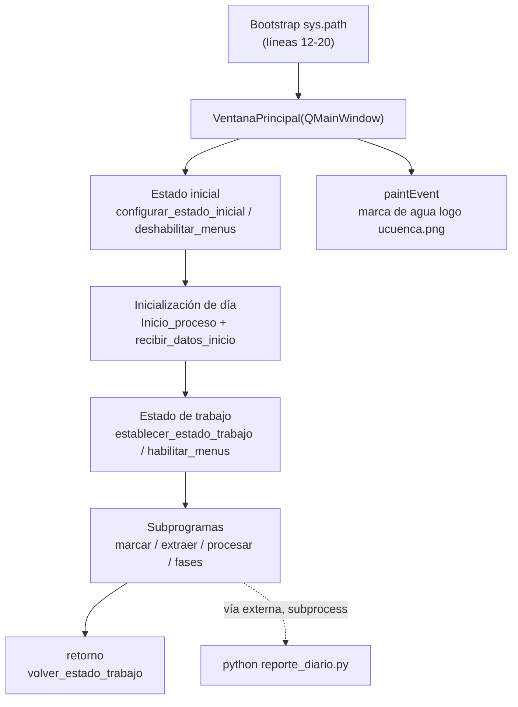

# `obsoletos/src/programa_integrado_alt.py` — Contexto Técnico (Módulo Archivado)

> Predecesor congelado de [`src/programa_integrado.py`](../../src/programa_integrado.py). **No es ejecutable, no se importa y no debe restaurarse.** Se conserva únicamente como respaldo histórico del orquestador principal.

**Ruta actual**: `obsoletos/src/programa_integrado_alt.py` (archivado el 2026-09-25)
**Ruta original**: `src/programa_integrado_alt.py`
**LOC**: 629 | **Lenguaje**: Python 3 (PyQt5, Matplotlib `Qt5Agg`) | **Proceso**: `python programa_integrado_alt.py` — **ya no funciona**

---

## 1. Qué es y por qué está archivado

Es una **versión anterior guardada** del orquestador principal del sistema. Su sucesor —[`src/programa_integrado.py`](../../src/programa_integrado.py), 750 líneas— es el punto de entrada oficial del programa integrado.

**Motivos del archivo (verificados el 2026-09-25)**:

1. **Ningún módulo lo importaba**: su única mención en el repositorio eran los reportes de auditoría, que se limitaban a contarlo.
2. **Es una versión gruardada muy vieja y no sirve** (valoración del usuario, dueño del proyecto).
3. **Está roto**: sus importaciones apuntan a símbolos que ya no existen (ver §2).
4. **Contaminaba la auditoría**: aparecía como un segundo importador de 5 subprogramas, falseando la topología real de dependencias.

---

## 2. Estado Verificado de Ejecutabilidad — ❌ ROTO

La línea 33 del archivo contiene:

```python
from subprogramas.procesamiento_integrado import Procesar_evento, verificar_drives_virtuales, FileMonitor, cargar_combo_eventos, activar_hilo
```

| Símbolo importado | Estado real en [procesamiento_integrado.py](../../src/subprogramas/procesamiento_integrado.py) | Resultado |
|:---|:---|:---:|
| `Procesar_evento` | `class Procesar_evento(QWidget)` — línea 138 | ✅ |
| `verificar_drives_virtuales` | `def verificar_drives_virtuales(...)` — línea 119 | ✅ |
| `cargar_combo_eventos` | `def cargar_combo_eventos(self, text)` — línea 57 | ✅ |
| `FileMonitor` | **No existe**: la clase pasó a llamarse `FileMonitorThread` (línea 75) | ❌ |
| `activar_hilo` | **No es importable**: hoy es un **método** (`def activar_hilo(self)` — línea 279), no una función de módulo | ❌ |

> **Conclusión**: si alguien intentara ejecutarlo, fallaría con `ImportError: cannot import name 'FileMonitor'` **antes de crear la ventana**. El módulo no es simplemente «no usado»: **es inarrancable**. Esto valida de forma objetiva la decisión de archivarlo.

---

## 3. Arquitectura Interna



* **Bootstrap de rutas** (líneas 12-20): `extraer_hasta_directorio(__file__, 'rsa_sismologia')` localiza la raíz del proyecto y luego inserta `src/librerias` y `datos` en `sys.path`. Verificado: **sigue resolviendo correctamente desde `obsoletos/src/`**, porque el nombre de la carpeta del proyecto aparece antes en la ruta.
* **Clase única** `VentanaPrincipal(QMainWindow)` (línea 44) con **37 métodos**, más un helper de módulo `extraer_hasta_directorio` (línea 4).

---

## 4. Inventario de Métodos Clave

| Grupo | Métodos |
|:---|:---|
| **Ciclo de inicialización** | `configurar_estado_inicial`, `inicializar_dia`, `cargar_widget_inicializacion`, `completar_inicializacion`, `cancelar_inicializacion`, `limpiar_widget_inicializacion`, `recibir_datos_inicio` |
| **Gestión de estado** | `establecer_estado_trabajo`, `cargar_widget_menu`, `limpiar_widget_actual`, `volver_estado_trabajo`, `limpiar_estado_completo`, `limpiar_variables_temporales` |
| **Menús** | `construccion_menu`, `habilitar_menus`, `deshabilitar_menus`, `actualizar_titulo` |
| **Acciones de procesamiento** | `marcar_eventos`, `extraer_eventos`, `procesamiento`, `mostrar_fases`, `reextracion` |
| **Configuración** | `seleccionar_drive`, `estaciones`, `enlaces_digitales`, `ingresar_datos_estacion_rg`, `ingresar_datos_estacion_ev`, `ingresar_IGEPN`, `ingresar_USGS` |
| **Informes** | `reporte_diario`, `reporte_periodo`, `reporte_enjambre`, `creacion_shapes` |
| **Cierre y pintado** | `salir`, `acerca_de`, `paintEvent` |

---

## 5. Diferencias Frente al Sucesor (`src/programa_integrado.py`)

| Aspecto | Módulo archivado | Sucesor vigente |
|:---|:---|:---|
| **Lanzamiento del reporte diario** | `subprocess.Popen(['python', 'reporte_diario.py'])` (línea 560) — proceso externo dependiente del `PATH` y del directorio actual | Subprograma montado **en proceso** como `QWidget` (`cargar_widget_menu`), conforme a ADR-003/ADR-004 |
| **Marca de agua** | `QPixmap('logo ucuenca.png')` con **ruta relativa codificada** y **sin `painter.end()`** — fuga de recurso de pintado | `resolver_ruta_recurso('logo rsa.png')` con cierre protegido por `try/finally` |
| **Menú de otras redes** | `self.menu_otras_redes` | `self.menu_otros_informes` |
| **Compatibilidad de importaciones** | Importa 5 subprogramas, 2 de ellos con símbolos inexistentes hoy | Importaciones verificadas y vigentes |
| **Topología** | Segundo importador (duplicaba el grafo de dependencias) | Único importador de los subprogramas (**topología en estrella**) |

---

## 6. Manejo Obligatorio de Este Archivo

1. **PROHIBIDO restaurarlo** a `src/` o añadirlo a `.bat`, menús o documentación operativa.
2. **PROHIBIDO importarlo** desde cualquier módulo.
3. **PROHIBIDO borrarlo** sin autorización expresa del usuario: es respaldo histórico.
4. Si en el futuro se necesita consultar un patrón antiguo del orquestador, **leerlo como referencia, nunca ejecutarlo** (está roto y su `paintEvent` filtra recursos).
5. El punto de entrada oficial y único es [`src/programa_integrado.py`](../../src/programa_integrado.py), lanzado con [`Programa principal.bat`](../../Programa%20principal.bat).

---

## 7. Riesgos Residuales

* **Falso positivo en auditorías**: si alguien vuelve a mover el archivo dentro de `src/`, los auditores lo contarán como módulo activo y volverán a distorsionar la topología de dependencias.
* **Confusión por nombre**: `programa_integrado_alt.py` puede confundirse con el punto de entrada real. Los reportes de auditoría ya no lo mencionan (regenerados el 2026-09-25).
* **Dependencia implícita del `PATH`**: el `subprocess.Popen(['python', ...])` apunta al `python` del sistema, lo que en su momento dependía del entorno activo (hoy: venv 3.9).

---

## 8. Alcance del Análisis Realizado

* **Método**: inventario completo de definiciones (`class`/`def`), lectura íntegra de la cabecera (líneas 1-40) y del bloque final (líneas 596-629), búsqueda dirigida de puntos de E/S y de operaciones destructivas (`open`, `write`, `remove`, `rename`, `shutil`, `subprocess`), y **contraste símbolo por símbolo** de sus importaciones contra el código vigente.
* **No se auditó** línea por línea el cuerpo de los 37 métodos: al tratarse de un módulo archivado e inarrancable, el análisis se orientó a **trazabilidad y prevención de uso indebido**, no a su funcionamiento interno.
* **No se ejecutó** el módulo (sería infructuoso: falla en la importación).

---

## 9. Checklist de Verificación

- [x] Confirmado que ningún módulo lo importa (grep en todo el repositorio).
- [x] Confirmado que sus importaciones están rotas (`FileMonitor`, `activar_hilo`).
- [x] Confirmado el traslado íntegro: 629 líneas conservadas.
- [x] Confirmado que los reportes de auditoría ya no lo mencionan.
- [x] Confirmado que el `.pyc` huérfano fue eliminado.
- [x] Registrado el estado `obsoleto_archivado` y las prohibiciones de uso.
